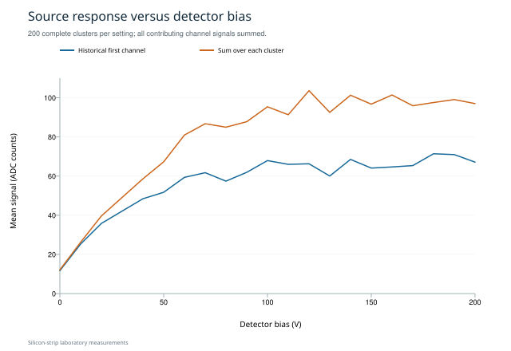

# Silicon-strip laboratory data workflow

A Python case study in turning detector-laboratory exports into traceable, validated results and structured electronic lab notebook records.

The work combines source selection, metadata, quality checks, reproducible processing, ELN access controls and a checked preservation transfer.



## Explore

- [Executed notebook](notebooks/measurement_workflow.ipynb): calibration, noise, laser scans and source response.
- `reports/figures/`: seven measurement plots.
- `data/derived/`: six aggregate result tables.
- [Workflow](docs/workflow.md): provenance, processing, interpretation and ELN review.
- [Data management](docs/data_management.md): DFG-structured plan and FAIR/EU mapping.
- [ELN setup](eln/README.md): local eLabFTW configuration and integration test.

The repository includes aggregate results and figures; source measurements are not included. Sample sizes and interpretation are described in the workflow guide.

## Run checks

Python 3.9 or later; the checks use only the standard library.

```bash
python3 scripts/validate_project.py
python3 -m unittest discover -s tests -v
python3 scripts/preserve_package.py --self-test
python3 scripts/check_repository.py
```

These check schemas, numeric values, source links, checksums, parsing and transfer integrity. To regenerate results from a source collection, follow the workflow guide.

## Attribution

Laboratory analysis: Melike Nur Erbek and Vinicius Goncalves de Oliveira. The MIT license applies to the code; laboratory results are attributed separately.
